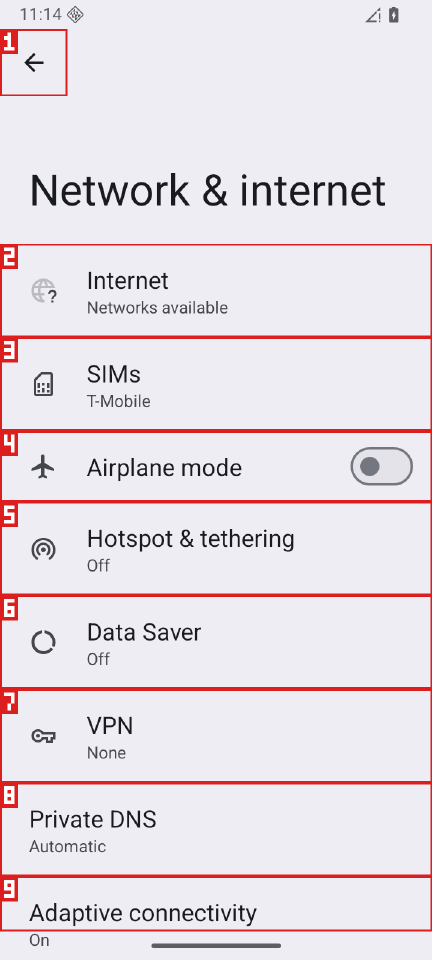
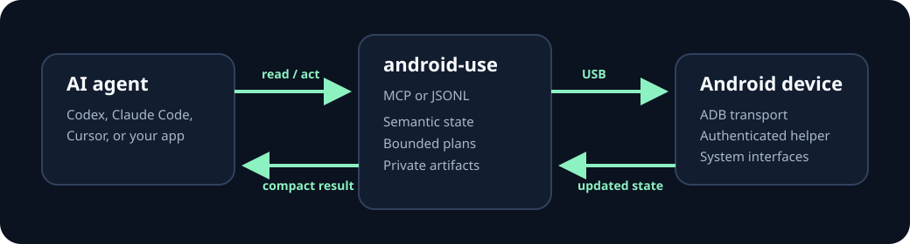

<p align="center"></p>

<h1 align="center">android-use</h1>
<p align="center"><strong>Give your AI agent an Android phone. Keep your hands on the leash.</strong></p>
<p align="center">Your agent opens apps, reads the screen, taps, types, and drives Chrome on a real phone or an emulator, in about two tool calls per task. You decide what it may touch.</p>

<p align="center">
  <a href="docs/guides/install.md"><strong>Install</strong></a> ·
  <a href="docs/agents/quickstart.md">Connect an agent</a> ·
  <a href="docs/guides/control.md">Control</a> ·
  <a href="docs/guides/emulators.md">Emulators</a> ·
  <a href="docs/README.md">Documentation</a> ·
  <a href="CHANGELOG.md">Changelog</a>
</p>

<p align="center">
  <a href="https://github.com/austinintelligence/android-use/actions/workflows/ci.yml"></a>
  <a href="https://www.npmjs.com/package/android-use"></a>
  <a href="https://github.com/austinintelligence/android-use/releases"></a>
  <a href="LICENSE"></a>
</p>

## What is android-use?

Your agent lives in a terminal and a browser. Most of the apps people use every day live on a phone. android-use connects the two: it gives the agent you already use (Claude Code, Codex, Cursor, Gemini CLI, and others) hands on a real Android phone or emulator.

There are two pieces. A small helper app on the device reads the screen through Android's accessibility service and carries out actions. `au`, on your computer, talks to the helper over ADB and gives your agent two tools: one to look, one to act. The agent asks in plain commands like `open app "Settings" then tap "Network & internet"` and gets back a short answer: the screen it reached, and after later actions, only what changed.

- **It reads text first.** The screen comes back as a list of what is there: labels, buttons, switches with their state (`sw Wi-Fi=on`), and fields with their contents. Agents act on labels, not on guessed coordinates. When an app shows little text, a small screenshot with a numbered box per control comes along, so `tap e4` still works.
- **It checks itself.** Every action is matched against the screen it was planned from, journaled so it runs at most once, and confirmed after. A locked phone, a screen that is off, or an ambiguous label stops it with the reason and the one step that fixes it, instead of a blind tap.
- **It remembers what worked.** Save a command that worked as a routine and run it again in one call. Every session leaves a trace you can review, export, or turn into a test.
- **You stay in charge.** A `policy.toml` decides which apps the agent may open, what it may capture, and how many steps it gets. Passwords are typed for the agent without the agent ever seeing them. For anything sensitive, the agent can ask the phone itself: you see the exact steps and tap Allow once or Deny, and the approval is void if the screen changed while you decided.

Developers use it to let their agent run the app it just built, report what it sees, and keep those runs as tests. Agents use it for real phone tasks end to end: checking settings, working through an app, reading a sign-in code from a notification, filling a form in Chrome. With a throwaway emulator, all of it can happen while your own phone stays in your pocket.

## One call, then only what changed

<table>
<tr>
<td width="38%"></td>
<td>

A real session on an Android emulator, over MCP. The agent sends one command; the result is the screen it led to.

```text
android_act: open app "Settings" then tap "Network & internet"
Done.
Now on screen:
Network & internet
Navigate up
Internet: AndroidWifi
SIMs: T-Mobile
sw Airplane mode=off
Hotspot & tethering: Off
...

android_act: tap "Airplane mode"
Done.
Changed:
~ Internet: Off
~ SIMs: T-Mobile [disabled]
~ sw Airplane mode=on
```

The picture is what the agent gets when a screen has little text: 17 KB, with a numbered box per control.

</td>
</tr>
</table>

Measured on an API 36 emulator over MCP, 13 tasks run 10 times each, against the same tasks before the changes in 1.1 ([method and numbers](docs/design/measurements.md)):

| | Before | Now |
| --- | --- | --- |
| Tool calls per task | 5.9 | **2.6** (2.3× fewer) |
| Input tokens per task | 5,356 | **1,186** (−78%) |
| Fixed tokens per turn (instructions + tool definitions) | 834 | **396** (−53%) |
| Output tokens per task | 117 | **53** |
| Tasks that succeeded | 64% | **98%** (127 of 130) |

## Get started

```sh
npx -y android-use@1.4.0 setup
```

That is the whole install for most people (it needs Node.js 20.11+). `setup` puts the helper on your device, registers android-use with every agent it finds, and ends by reading your screen back to you. Or tell your agent to do it:

```text
Run `npx -y android-use@1.4.0 setup`, follow its prompts, then use android_read and android_act.
```

You need Android 8 or newer with USB debugging on, or an emulator. No root. Android asks you to allow USB debugging and to turn on **Android-Use** under Settings → Accessibility; android-use never skips those prompts.

<details><summary><strong>Homebrew, shell installer, Windows</strong></summary><br>

```sh
brew install austinintelligence/tap/android-use && au setup
curl -fsSL https://raw.githubusercontent.com/austinintelligence/android-use/v1.4.0/install/install.sh | ANDROID_USE_VERSION=1.4.0 sh && au setup
```

On Windows, run `install/install.ps1` in PowerShell, or unzip the archive from [Releases](https://github.com/austinintelligence/android-use/releases) and run `.\au.exe setup`. `au` runs on macOS (Apple Silicon and Intel), Linux (x86_64 and arm64), and Windows (x86_64 and arm64). Every download is checked against `SHA256SUMS`, and the archive contains `au` with the helper built in. [Step by step →](docs/guides/install.md)

</details>

To register one agent yourself: `au install claude` (also `codex`, `cursor`, `gemini`, `vscode`, `claude-desktop`, `opencode`, `all`), or `au install --dry-run` to see what would change. Only the `android-use` entry is touched ([client details](docs/agents/clients.md)). Coding agents can start with [AGENTS.md](AGENTS.md).

## Two tools, plain language

`android_read` looks: `screen`, `page`, `notifications`, `routines`, `policy`, `help`. `android_act` does:

```text
tap "Wi-Fi"                     set "Airplane mode" on           type "hello" in "Message"
open app "Chrome"               scroll down until "Privacy"      open app "Settings" then tap "Battery"
wait for notification from "Bank" up to 60 seconds
type secret "bank pin" in "PIN"
save routine "set timeout" from last with "30 seconds"
run routine "set timeout" with "1 minute"
ask phone "Pay $25 to Alex?" then tap "Pay $25"
```

The same commands work from a shell, no MCP needed: `au read screen`, `au act 'tap "Wi-Fi"'`. Miss a label and the reply lists the near matches and a ready-to-send fix. Hit a locked phone or a stopped helper and it says exactly that. Every form: `android_read help`, or the [agent protocol](docs/reference/agent-protocol.md).

## What your agent can do with it

- **Use apps** the way a person would: open, read, tap, type, scroll, go back, chain steps with `then`
- **Drive Chrome**: open pages, click, fill, read, screenshot, through Chrome's own debugging socket
- **Remember routines**: save a command that worked, with a value as a parameter, and replay it in one call
- **Sign in safely**: type a stored secret into a password field without seeing it, and read a one-time code from a notification (`read code from notification "Bank"`) for apps you list
- **Read the phone**: notifications (and act on them) and one-shot location, when you allow them
- **Capture**: screenshots; camera, microphone, and screen recording with Android's permission
- **Turn runs into tests**: `au trace to-test` writes a session out as a test, and `au test` runs files of the same plain commands with `expect screen` checks and JUnit output for CI ([app testing](docs/guides/app-testing.md))
- **Work on emulators**: managed emulators with snapshots, side by side with your real phone

[Capability details →](docs/reference/capabilities.md)

## No phone handy? Use an emulator

```sh
au emulator doctor           # needs the Android SDK; if it finds none, install Android Studio or the command-line tools
au emulator install          # fetch the missing emulator package and system image (you accept Google's license)
au emulator create demo
au emulator start demo
au --target demo setup       # then turn on Android-Use in the emulator's Accessibility settings
```

Each emulator is its own target with its own enrollment, journal, and serve lock, so an agent can work on one while you use your phone. Snapshots, restarts, and identity checks: [Emulators and targets](docs/guides/emulators.md).

## Safe to hand your phone to

- **One device.** A session is bound to one enrolled phone or emulator, checked on every connection, and the helper must answer a fresh cryptographic challenge before `au` sends it anything.
- **Your policy, your rules.** `policy.toml` sets allowed and denied apps, extra risky words, a step cap, whether anything may be captured, which apps codes may be read from, and the one folder files may move through. A file that does not parse stops the session; it never means "no policy". While a denied app is in front, only back and home work.
- **Secrets stay secret.** Values live in the system's secret store (macOS Keychain, Secret Service on Linux, per-user DPAPI on Windows), are typed only into a field the helper flags as a password field in an app you allowed, and are removed from every reply, error, trace, and routine.
- **Approvals happen on the phone.** While the prompt waits, the helper runs no actions at all, so no agent can tap Allow for you, and it never shows over the lock screen. The agent also cannot answer Android's own system permission prompts.
- **You can stop it.** `au watch` prints a link to a page on your computer that shows each command as it runs, with **Pause** and **Stop**. The helper's notification has a Stop button too.
- **Nothing extra.** The helper has no internet permission, `au` exposes no shell, and every action is bounded in size and time.



The full model: [SECURITY.md](SECURITY.md) and the [control guide](docs/guides/control.md). Under the hood: [Architecture](docs/concepts/architecture.md).

## Documentation

| I want to… | Read |
| --- | --- |
| Get it running | [Install](docs/guides/install.md), [Troubleshooting](docs/guides/troubleshooting.md) |
| Connect Codex, Claude Code, Cursor, … | [Agent quickstart](docs/agents/quickstart.md), [client setup](docs/agents/clients.md) |
| Set limits, secrets, approvals, routines | [Control](docs/guides/control.md) |
| Test my app | [App testing](docs/guides/app-testing.md) |
| Look up a command | [CLI](docs/reference/cli.md), [agent protocol](docs/reference/agent-protocol.md), [environment](docs/reference/environment.md) |
| Run on emulators | [Emulators and targets](docs/guides/emulators.md) |
| Understand the cost numbers | [Token budget](docs/concepts/token-budget.md) |
| Run it unattended | [Production guidance](docs/guides/production.md), [security model](docs/concepts/security-model.md) |
| Contribute or cut a release | [Development](docs/contributing/development.md), [testing](docs/contributing/testing.md), [releasing](docs/contributing/release.md) |

## FAQ

<details><summary><strong>Does it include an AI model?</strong></summary><br>No. It gives the agent you already use a compact, checked Android interface.</details>

<details><summary><strong>Can it type my password without learning it?</strong></summary><br>Yes. Add it once with <code>printf %s "$PIN" | au secret add "bank pin" --apps com.example.bank</code>. The agent then sends <code>type secret "bank pin" in "PIN"</code>, and the value never appears in anything it gets back. <code>au secret list</code> shows names only; <code>au secret remove NAME</code> deletes one.</details>

<details><summary><strong>Does it need screenshots?</strong></summary><br>Usually not. The text screen is smaller and names every control the agent can use. When a screen has little text, or a label is not found, a compressed screenshot with numbered boxes is attached, and <code>tap point X Y</code> on it maps back to exact device pixels.</details>

<details><summary><strong>Does my phone need to be rooted?</strong></summary><br>No. It uses USB debugging and Android's accessibility service, both granted by you.</details>

<details><summary><strong>Can it wander onto the wrong device?</strong></summary><br>No. A session is bound to one enrolled device or emulator target, checked every time it connects.</details>

<details><summary><strong>Wi-Fi instead of USB?</strong></summary><br>Release testing uses USB. Wireless ADB works as an advanced transport; secure it like physical access.</details>

<details><summary><strong>Where do captures, traces, and logs go?</strong></summary><br>They stay on your machine in a private folder. Captures and traces older than 7 days are deleted the next time Android Use opens that device, and the journal keeps operation metadata, never screen or media contents. <code>au uninstall</code> removes the helper, the journal, and captures; stored secrets stay in your system's secret store until <code>au secret remove</code>. See <a href="SECURITY.md">Security</a>.</details>

## Status

android-use targets Android 8 and newer; the automated checks run on an Android 16 (API 36) emulator. Optional capabilities vary by device, and `au doctor` says what a connected one supports. The 1.4 control features are covered by unit and flow tests; the [changelog](CHANGELOG.md) lists what has not been run on a device yet.

MIT licensed. Contributions are welcome: see [CONTRIBUTING.md](CONTRIBUTING.md). If android-use earns a place in your setup, a star helps the next person find it.
