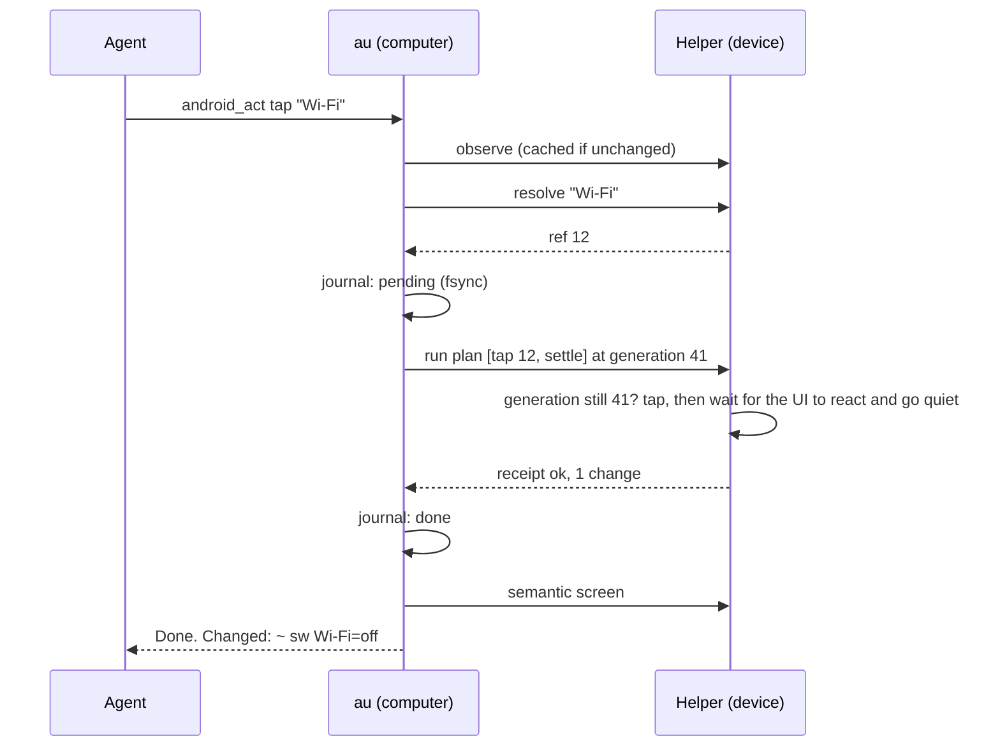

# Architecture

Android Use has two halves: `au`, a Rust binary on the computer, and a small Java helper app on the device. They talk through an authenticated socket forwarded by ADB. Chrome is reached separately through its own on-device debugging socket.

## One action, end to end

## Host modules (`computer/src`)

| Module | Responsibility |
| --- | --- |
| `adapter.rs` | MCP over stdio: framing, lifecycle, tool routing. |
| `command.rs` | The plain command grammar and the MCP tool definitions. |
| `agent.rs` | Agent-facing execution: compiles commands to plans, resolves labels and handles, summarizes results and the screen (or its changes) afterwards. |
| `spec.rs` | The one table of command forms: tool descriptions, `help`, the installed protocol reference, and the grammar tests come from it. |
| `clients.rs` | `au install` / `au uninstall`: registers the MCP server (and skill) with agent clients without touching their other settings. |
| `marks.rs` | Numbered boxes drawn on screen images (set-of-marks), so a model that must look answers `tap eN`. |
| `resolve.rs` | One matching rule for every surface: exact beats substring, `number N` picks, otherwise ambiguous. |
| `format.rs` | Pure text rendering: screens, pages, receipts, failures, recovery guidance. |
| `engine.rs` | Execution core: lazy device link, reconnects, journaled plan execution, artifacts. |
| `journal.rs` | At-most-once operation journal. |
| `bridge.rs` / `browser.rs` | Helper protocol and Chrome DevTools clients. |
| `device.rs` / `install.rs` | ADB discovery, enrollment, setup, and `doctor`. |
| `compress.rs` | Content-aware screenshot compression and the image-to-device coordinate map. |
| `visual.rs` / `artifact.rs` | PNG crop, hash, and diff; private local artifacts. |
| `api.rs` | Shared types and wire encoding. |

## Safety invariants

- **Generation checks.** Every plan carries the UI generation it was compiled against. The helper parses and bounds the whole plan, then checks the generation immediately before the first change and re-validates each later target (same window, bounds, and label) before acting on it, stopping at the first failure.
- **At most once.** The host durably records a pending digest before sending a plan. If a process ends with a plan pending, new actions are refused as `unknown` until the agent reads the device, so the uncertain plan is never silently repeated. Operation ids are scoped to one process, so a client that restarts and reuses request ids cannot collide with older records.
- **Bounded everything.** Frames, plans, waits, text, artifacts, and every response sent to an agent have hard limits.
- **No escape hatches.** No shell, no arbitrary page JavaScript, an allowlist of settings screens, and links limited to http(s), `geo:` and `google.navigation:`. The helper has no `INTERNET` permission and only accepts the ADB shell user.

## Speed

- The helper connection persists for the life of the server and reconnects once on transport errors. It and Chrome DevTools are opened by speaking the adb server's own protocol (`host:transport`, then `localabstract:`): no `adb` process runs and no port forward exists to leak.
- The helper settles inside the plan: it waits for the screen to react, then to go quiet (and, after a launch, for that app to be in front), so the host never polls.
- Unchanged screens are not re-sent: observation is keyed by generation.
- Device artifacts download in 256 KiB slices. Older helpers fall back to 2.8 KB slices.
- Screenshots are compressed before they reach the agent (see below), which keeps responses small and makes coordinates exact.
- Results include the settled screen, so agents spend fewer turns on reads.

## Screen image compression

A raw screenshot is 1–4 MB. `compress.rs` shrinks it in four steps, typically in 25–35 ms:

1. **Classify** a sample of pixels as dense UI text, ordinary UI, or sparse content, using edge density, dominant color, and color variety. Both horizontal neighbors are checked and sampled columns shift per row band, so periodic patterns like tile grids cannot hide from the stride.
2. **Resize** with an area-averaging filter. Dense text keeps up to 1568 px on the long edge (the most a vision model keeps anyway); ordinary UI 1280; sparse content 960. Never upscaled, never above about 1.15 megapixels.
3. **Quantize** to an indexed PNG. Screens with 256 or fewer colors (most UI) are reproduced exactly; others use median cut over a 15-bit histogram with palette entries averaged from real pixels.
4. **Meet a byte budget** (350 KB) by retrying with 64, 32, then 16 colors and slightly fewer pixels, keeping the smallest result if none fits. Captures that are already small and correctly sized pass through untouched.

The agent is told the image size, the device size, and the scale, and every `tap point`/`swipe` coordinate is mapped back through the same record (`ImageSpace`) to the device pixel under the pixel's center. A point outside the image, or a screen that has rotated since the image was taken, produces a corrected-context message instead of a misplaced tap. `image hash` and `image difference` use the full-resolution capture, so two screens compressed to different sizes still compare correctly.
